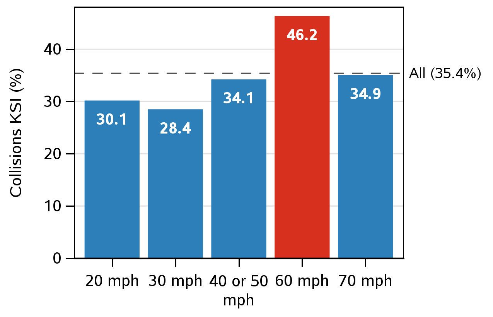
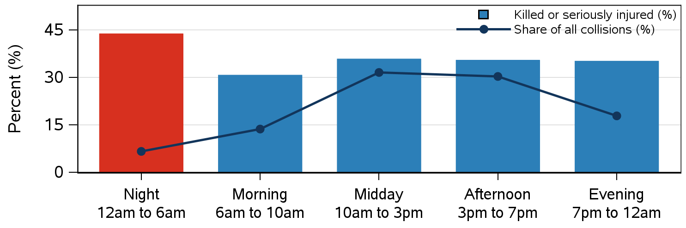
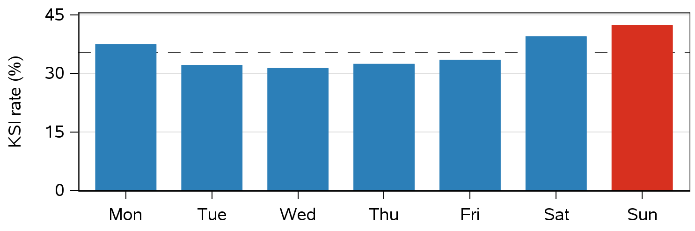
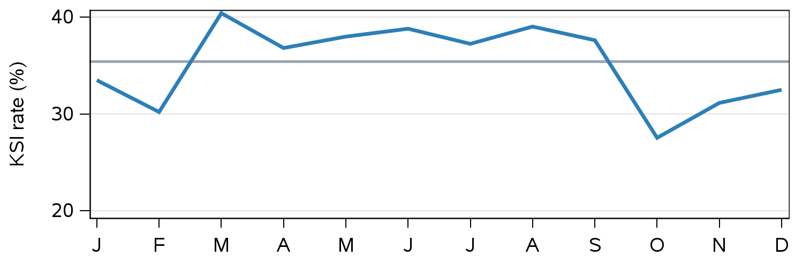
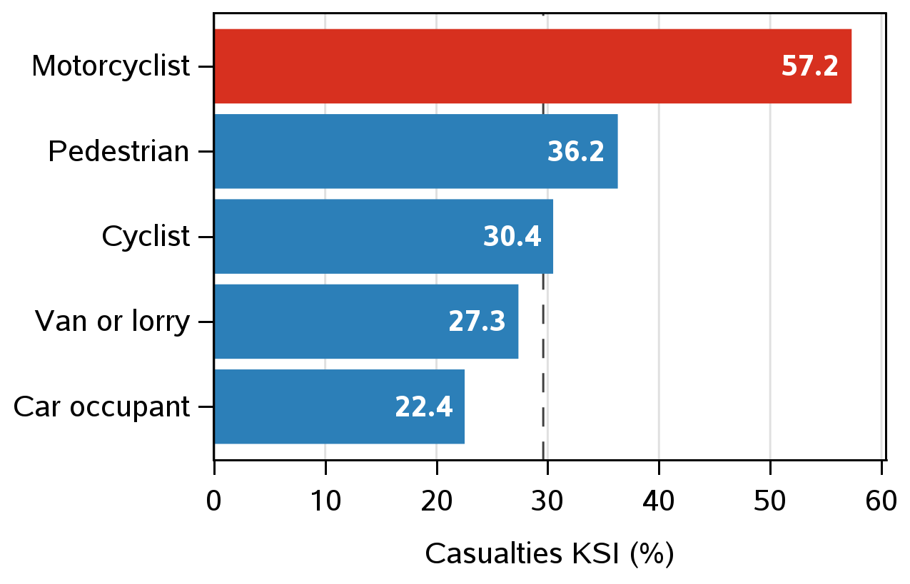
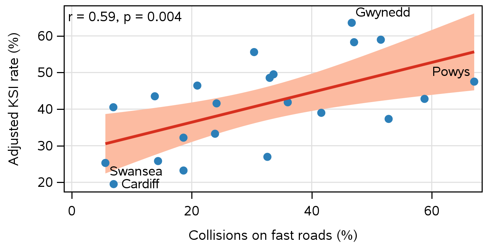
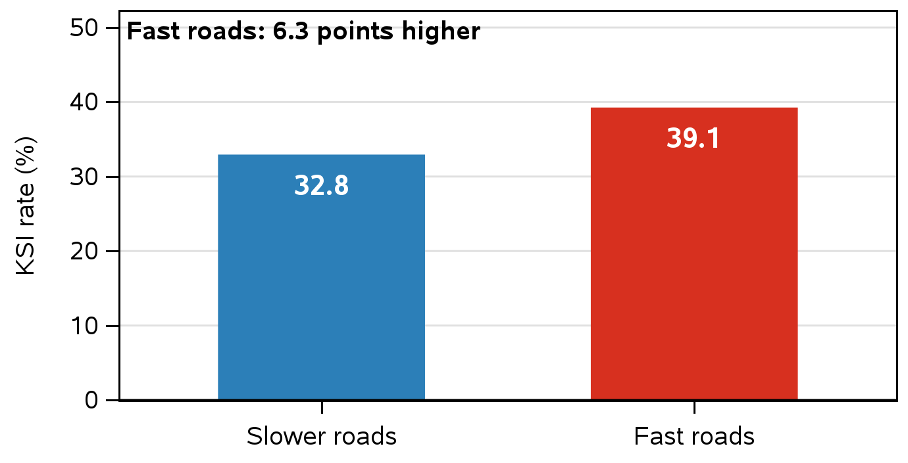
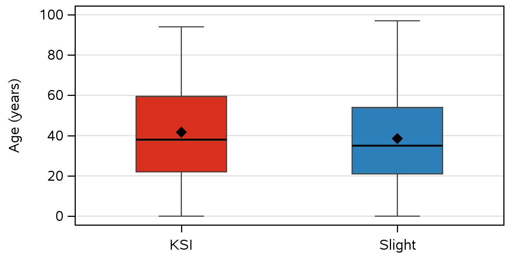

# Road Speed and Injury Severity in Wales

**A statistical analysis of STATS19 police collision data, 2025**

MS4S08 Applied Statistics · University of South Wales 
**Team DOG:** H. Ali · F. Fashina · A. Mayaki · M. Okoro · M. Siddiqui

---

## Summary

We analysed every police-reported injury collision in Wales in 2025 to find where serious harm concentrates. **Collisions on faster roads, above all rural 60 mph single carriageways, are more likely to kill or seriously injure**, both across and within councils. Motorcyclists are the most affected.

| 3,004 | 4,078 | 35.4% | 46.2% | 57.2% |
|:---:|:---:|:---:|:---:|:---:|
| collisions | casualties | of collisions killed or seriously injured (KSI) | KSI on 60 mph roads | of injured motorcyclists KSI |

---

## Research question

> In Wales in 2025, are collisions on faster roads more likely to cause death or serious injury, and who is most affected?

---

## Key findings

1. **60 mph roads are the most dangerous:** 46.2% of collisions were KSI, against 35.4% overall.
2. **Councils with more fast-road crashes have more serious harm:** r(20) = 0.59, p = 0.004.
3. **Within the same council, fast roads are worse:** +6.3 points KSI (95% CI 2.7 to 10.0), p = 0.002.
4. **Night crashes are the fewest but the most severe:** 43.7% KSI between 12am and 6am.
5. **Motorcyclists face the highest risk:** 12.6% of casualties, but 57.2% of them KSI.

 <em>Share of collisions that killed or seriously injured, by speed limit.</em>

---

## Data and methods

| | |
|---|---|
| **Data** | STATS19, Department for Transport (2026): 3,004 collisions and 4,078 casualties in 22 Welsh councils, 2025 |
| **KSI** | Killed or seriously injured |
| **Fast roads** | 60 or 70 mph; slower roads: 20 to 50 mph |
| **Tool** | SAS OnDemand for Academics; all tests at α = 0.05 after assumption checks |

| Test | Question | Result |
|---|---|---|
| Pearson correlation | Do councils with more fast-road crashes have higher KSI rates? | r(20) = 0.59, p = 0.004 |
| Paired t test | Within each council, are fast roads worse than slower roads? | +6.3 points, t(21) = 3.59, p = 0.002 |
| Mann-Whitney U | Are KSI casualties older than slight casualties? | Median 38 vs 35, Z = 3.97, p < 0.001 |

<b>Show hypotheses and assumption checks</b>

**Test 1. Pearson correlation (22 councils)**
H0: no correlation between a council's share of fast-road collisions and its KSI rate. H1: a correlation exists.
Both variables normal (Shapiro-Wilk p > 0.5). Uses DfT adjusted severity; recorded severity gives r = 0.69. Reject H0.

**Test 2. Paired t test (22 councils)**
H0: the mean difference in KSI rate (fast minus slower roads) is zero. H1: it is not zero.
Differences normal (Shapiro-Wilk p = 0.11). 14 of 22 councils were higher on fast roads; the Wilcoxon signed rank test agrees (p = 0.002). Reject H0.

**Test 3. Mann-Whitney U (4,028 casualties)**
H0: KSI and slight casualties have the same age distribution. H1: they differ.
Age not normal (Shapiro-Wilk p < 0.001). Shift of 3 years (95% CI 1 to 4); a small effect. Reject H0.

---

## Charts

All charts were made in SAS (`PROC SGPLOT`). Red marks the highest-risk group.

<b>Show all eight charts</b>

 

**Figure 1.** Time of day: KSI rate (bars) and share of collisions (line) 

**Figure 2.** KSI rate by day of week 

**Figure 3.** KSI rate by month 

**Figure 4.** KSI rate by speed limit 

**Figure 5.** KSI rate by road user 

**Figure 6.** Test 1: fast road share vs adjusted KSI rate, by council 

**Figure 7.** Test 2: average KSI rate on slower and fast roads 

**Figure 8.** Test 3: age by severity group 

---

## Limitations

- One year of police-reported data only
- Fast roads and rural areas overlap (r = 0.94), so their effects cannot be separated
- Casualties in the same collision are not independent

---

## Repository

| Folder | Contents |
|---|---|
| `Data/` | Cleaned data (CSV) |
| `Scripts/` | Six SAS programs, run in order: `01_import`, `02_clean`, `03_eda`, `04_tests`, `05_charts`, `06_export` |
| `Charts/` | The eight poster charts (PNG, 300 dpi) |
| `Poster/` | Final A2 poster (PDF), added after submission |

**To reproduce:** download the 2025 collision and casualty files from [DfT Road Safety Data](https://findtransportdata.dft.gov.uk/dataset/road-safety-data), save them in a `stats19_project` folder in SAS OnDemand, and run the scripts in order.

**Next:** a Power BI dashboard and a multi-year analysis adjusting for rurality.

---

## References

Department for Transport (2025) *Reported road casualties Great Britain, annual report: 2024*. Available at: https://www.gov.uk/government/statistics/reported-road-casualties-great-britain-annual-report-2024 (Accessed: 15 October 2026).

Department for Transport (2026) *Road Safety Data*. Available at: https://findtransportdata.dft.gov.uk/dataset/road-safety-data (Accessed: 14 October 2026).

Elvik, R. (2013) 'A re-parameterisation of the Power Model of the relationship between the speed of traffic and the number of accidents and accident victims', *Accident Analysis and Prevention*, 50, pp. 854 to 860. doi:10.1016/j.aap.2012.07.012.

Senedd Research (2026) *What impact has 20mph had on road safety in Wales?* Available at: https://research.senedd.wales/research-articles/what-impact-has-20mph-had-on-road-safety-in-wales/ (Accessed: 15 October 2026).

Welsh Government (2023) *Seven things you may not know about Wales' new 20mph default speed limit*. Available at: https://gov.wales/seven-things-you-may-not-know-about-wales-new-20mph-default-speed-limit (Accessed: 15 October 2026).

---

**Licence:** code under the [MIT License](LICENSE). Data derived from DfT STATS19, under the [Open Government Licence v3.0](https://www.nationalarchives.gov.uk/doc/open-government-licence/version/3/).
