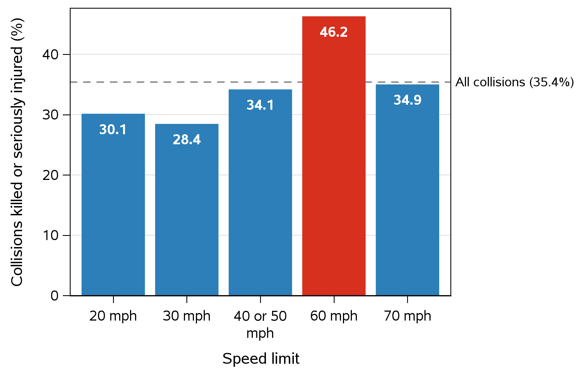
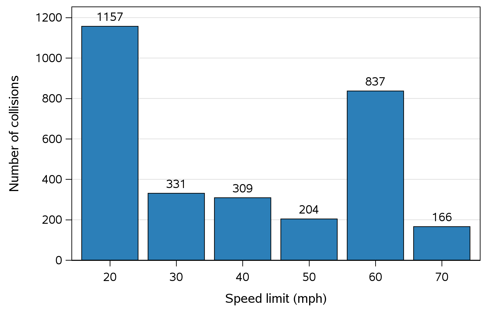
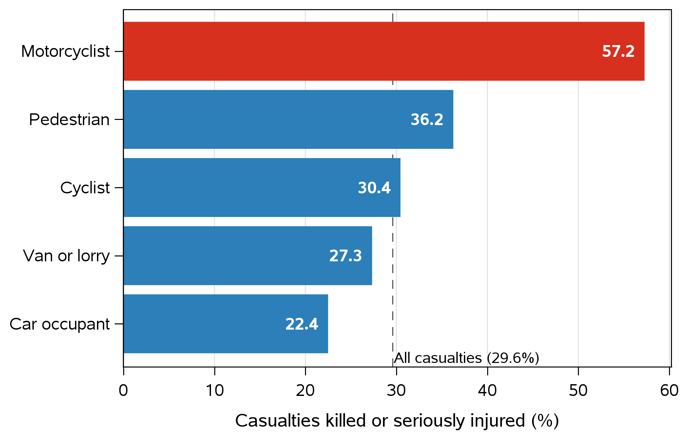
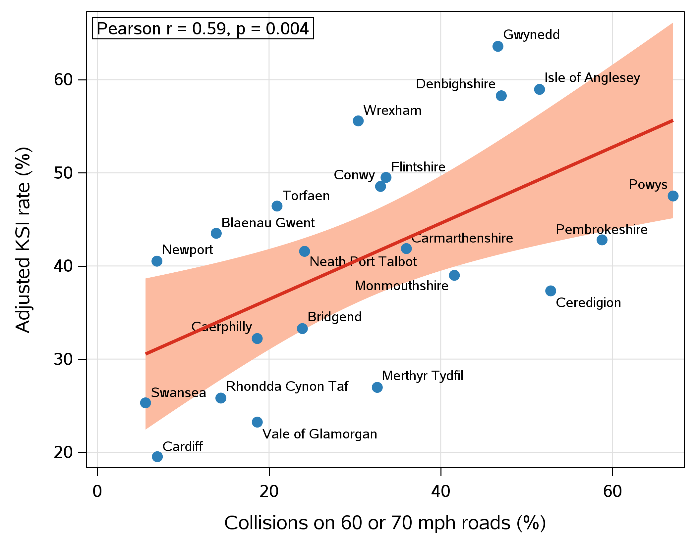
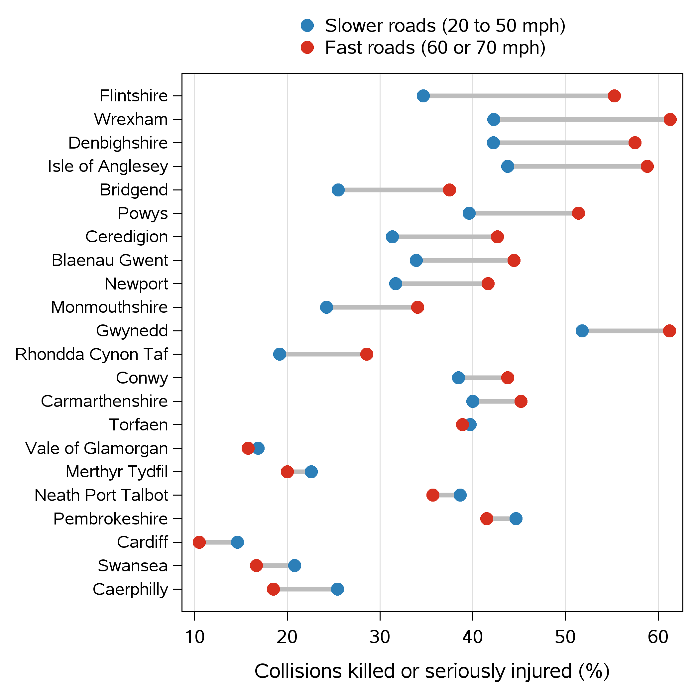
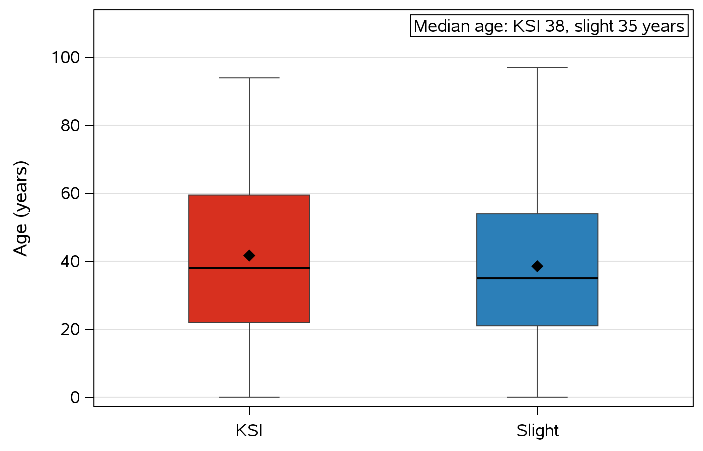

<div align="center">

# Road Speed and Injury Severity in Wales

### A statistical analysis of STATS19 police collision data, 2025


**MS4S08 Applied Statistics · MSc Data Science · University of South Wales**

**Team DOG:** H. Ali · F. Fashina · A. Mayaki · M. Okoro · M. Siddiqui

</div>

---

> **Key finding:** 46% of collisions on 60 mph roads in Wales killed or seriously injured someone, against 35% across all roads. Serious harm concentrates on fast, rural, single carriageway roads.

<div align="center">

| 3,004 | 4,078 | 1,207 | 35.4% | 63% |
|:---:|:---:|:---:|:---:|:---:|
| collisions | casualties | killed or seriously injured | of collisions KSI | of collisions rural |

</div>

---

## Contents

1. [Background](#background)
2. [Research question](#research-question)
3. [Key findings](#key-findings)
4. [Data](#data)
5. [Workflow](#workflow)
6. [Methods and results](#methods-and-results)
7. [Charts](#charts)
8. [Discussion](#discussion)
9. [Repository structure](#repository-structure)
10. [How to reproduce](#how-to-reproduce)
11. [Roadmap](#roadmap)
12. [References](#references)
13. [Licence](#licence)

---

## Background

Speed is a leading factor in road injury severity: crash numbers rise with speed, and fatal crashes rise fastest, especially on rural roads (Elvik, 2013). In September 2023, Wales made 20 mph the default limit on most residential roads (Welsh Government, 2023), and public debate has focused on towns.

This project asks a different question: **where does serious harm concentrate across Welsh roads now?**

## Research question

> In Wales in 2025, are collisions on faster roads more likely to cause death or serious injury, and who is most affected?

**Objectives**

1. Describe collisions and casualties through exploratory analysis
2. Test the link between road speed and injury severity, across and within councils
3. Identify the casualties most affected

---

## Key findings

| # | Finding | Evidence |
|:---:|---|---|
| 1 | 60 mph roads had the highest KSI rate; 98% were rural and 97% single carriageway | 46.2% KSI, against 35.4% overall |
| 2 | Councils with more collisions on fast roads had higher KSI rates | Pearson r = 0.59, p = 0.004 |
| 3 | Within the same council, fast roads were more dangerous than slower roads | +6.3 points (95% CI 2.7 to 10.0), p = 0.002 |
| 4 | Motorcyclists were the most affected road users | 12.6% of casualties, but 57.2% of them KSI |
| 5 | KSI casualties were slightly older than slight casualties | Median 38 vs 35 years, p < 0.001 |

<div align="center">



*KSI rate by speed limit. 60 mph roads stand out; 70 mph roads, mostly dual carriageways, are near average.*

</div>

---

## Data

| | |
|---|---|
| **Source** | STATS19 road safety data, Department for Transport (2026) |
| **Coverage** | All police reported injury collisions in Great Britain, 2025 |
| **Scope** | Filtered to Wales's 22 local authorities |
| **Size** | 3,004 collisions and 4,078 casualties (91 killed, 1,116 seriously injured) |
| **Missing data** | Unknown codes set to missing; age unknown for 50 casualties (1.2%) |

**Key terms**

- **KSI:** killed or seriously injured
- **Adjusted severity:** the DfT correction for police forces recording injury severity differently. Test 1 uses it so councils can be compared fairly.

The raw DfT files are not included because of their size. Download them from the source in the [references](#references).

---

## Workflow


---

## Methods and results

All analysis was carried out in SAS OnDemand for Academics. Every test used a significance level of 0.05, with assumptions checked before testing and a robustness check afterwards.

| Test | Data | Assumption check | Result |
|---|---|---|---|
| 1. Pearson correlation | 22 councils | Normality (Shapiro-Wilk), linearity | r = 0.59, p = 0.004 |
| 2. Paired t test | 22 councils, fast vs slower roads | Normal differences (Shapiro-Wilk p = 0.11) | +6.3 points, p = 0.002 |
| 3. Mann-Whitney U | 4,028 casualties | Age not normal (Shapiro-Wilk p < 0.001) | Shift of 3 years, p < 0.001 |

<details>
<summary><b>Test 1: Pearson correlation, across councils</b></summary>

- **H0:** no correlation between the share of collisions on 60 or 70 mph roads and the KSI rate
- **H1:** a correlation exists
- **Assumptions:** both variables normal (Shapiro-Wilk p > 0.5); relationship linear (Figure 4)
- **Result:** r = 0.59, p = 0.004, using adjusted severity. **Reject H0.**
- **Robustness:** recorded severity gives r = 0.69, p < 0.001

</details>

<details>
<summary><b>Test 2: Paired t test, within councils</b></summary>

- **H0:** the mean within council difference in KSI rate (fast minus slower roads) is zero
- **H1:** the mean difference is not zero
- **Why paired:** each council is compared with itself, so differences in rurality and police recording cancel out
- **Assumption:** differences normal (Shapiro-Wilk p = 0.11)
- **Result:** +6.3 percentage points (95% CI 2.7 to 10.0), t(21) = 3.59, p = 0.002. **Reject H0.**
- **Robustness:** Wilcoxon signed rank test agrees (p = 0.002); so does a rerun without the two councils with fewer than 10 fast road collisions

</details>

<details>
<summary><b>Test 3: Mann-Whitney U, age by severity</b></summary>

- **H0:** KSI and slight casualties have the same age distribution
- **H1:** the distributions differ
- **Why non-parametric:** age was not normal (Shapiro-Wilk p < 0.001)
- **Result:** median 38 vs 35 years; Hodges-Lehmann shift of 3 years (95% CI 1 to 4), p < 0.001. **Reject H0.** A small effect.
- **Robustness:** a two sample t test agrees

</details>

---

## Charts

All charts were produced in SAS with `PROC SGPLOT`. **Red** marks the group with the highest risk; **blue** marks all other groups.

| | |
|:---:|:---:|
|  |  |
| **Figure 1.** Collisions by speed limit | **Figure 2.** KSI rate by speed limit |
|  |  |
| **Figure 3.** KSI rate by road user | **Figure 4.** Fast road share vs adjusted KSI rate, by council |
|  |  |
| **Figure 5.** Fast vs slower road KSI rate, within each council | **Figure 6.** Age by severity group |

---

## Discussion

The results agree with the Power Model, in which speed affects fatal crashes most strongly on rural roads (Elvik, 2013). Across Great Britain, rural roads carry 45% of traffic but 60% of deaths (DfT, 2025a), and 69% of motorcyclist deaths occur on rural roads (DfT, 2025b), consistent with the high motorcyclist KSI rate found here.

Since the 20 mph default, casualties on Welsh 20 and 30 mph roads have fallen by 23.8% (Senedd Research, 2026). Our results suggest the serious harm that remains lies on rural 60 mph roads, so alongside 20 mph in towns, road safety effort could target rural 60 mph routes.

**Limitations**

- One year of police reported injuries only
- Fast roads and rural areas overlap strongly (r = 0.94), so their effects cannot be separated
- Casualties in the same collision are not independent

---

## Repository structure

```
wales-road-safety-2025/
├── Data/       Cleaned data (CSV): collisions, casualties, council summaries
├── Scripts/    Six SAS programs, run in order
├── Charts/     Six poster charts (PNG, 300 dpi)
├── Poster/     Final A2 poster (PDF), added after submission
├── LICENSE
└── README.md
```

| Script | Purpose |
|---|---|
| `01_import.sas` | Import the raw collision and casualty files |
| `02_clean.sas` | Filter to Wales, recode, join casualties to collisions, check the recoding |
| `03_eda.sas` | Exploratory data analysis |
| `04_tests.sas` | Three hypothesis tests with assumption and robustness checks |
| `05_charts.sas` | The six poster charts |
| `06_export_data.sas` | Save the cleaned tables as CSV |

---

## How to reproduce

1. Download the 2025 collision and casualty CSV files from the [DfT Road Safety Data](https://findtransportdata.dft.gov.uk/dataset/road-safety-data) page
2. In SAS OnDemand for Academics, create a folder named `stats19_project` and save the files as `collisions_2025.csv` and `casualties_2025.csv`
3. Update the folder path at the top of each script if yours differs
4. Run the scripts in order, `01` to `06`

---

## Roadmap

- [x] Data import, cleaning and validation
- [x] Exploratory analysis and summary statistics
- [x] Three hypothesis tests with robustness checks
- [x] A2 academic poster
- [ ] Interactive Power BI dashboard *(coming soon)*
- [ ] Extension to several years of data, with a model adjusting for rurality

---

## References

Department for Transport (2025a) *Reported road casualties Great Britain, annual report: 2024*. Available at: https://www.gov.uk/government/statistics/reported-road-casualties-great-britain-annual-report-2024 (Accessed: 15 October 2026).

Department for Transport (2025b) *Reported road casualties Great Britain: motorcyclist factsheet 2024*. Available at: https://www.gov.uk/government/statistics/reported-road-casualties-great-britain-motorcyclist-factsheet-2024 (Accessed: 15 October 2026).

Department for Transport (2026) *Road Safety Data*. Available at: https://findtransportdata.dft.gov.uk/dataset/road-safety-data (Accessed: 14 October 2026).

Elvik, R. (2013) 'A re-parameterisation of the Power Model of the relationship between the speed of traffic and the number of accidents and accident victims', *Accident Analysis and Prevention*, 50, pp. 854 to 860. doi:10.1016/j.aap.2012.07.012.

Senedd Research (2026) *What impact has 20mph had on road safety in Wales?* Available at: https://research.senedd.wales/research-articles/what-impact-has-20mph-had-on-road-safety-in-wales/ (Accessed: 15 October 2026).

Welsh Government (2023) *Seven things you may not know about Wales' new 20mph default speed limit*. Available at: https://gov.wales/seven-things-you-may-not-know-about-wales-new-20mph-default-speed-limit (Accessed: 15 October 2026).

---

## Licence

| Content | Licence |
|---|---|
| Code (`Scripts/`) | MIT License, see [`LICENSE`](LICENSE) |
| Data (`Data/`) | Derived from DfT STATS19 data. Contains public sector information licensed under the [Open Government Licence v3.0](https://www.nationalarchives.gov.uk/doc/open-government-licence/version/3/) |
| Charts and poster (`Charts/`, `Poster/`) | [Creative Commons Attribution 4.0](https://creativecommons.org/licenses/by/4.0/) |

<div align="center">

*Team DOG · University of South Wales · 2026*

</div>
